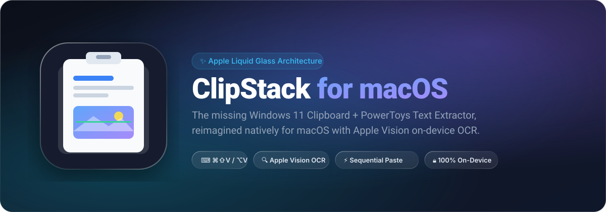
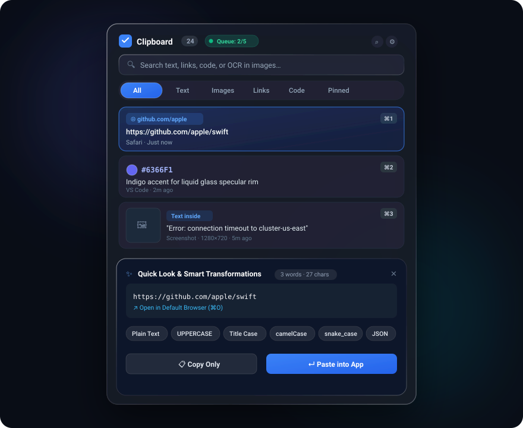
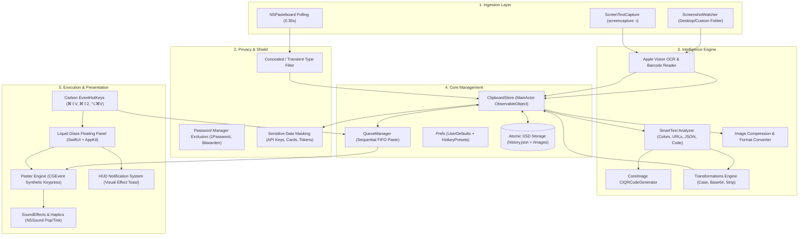
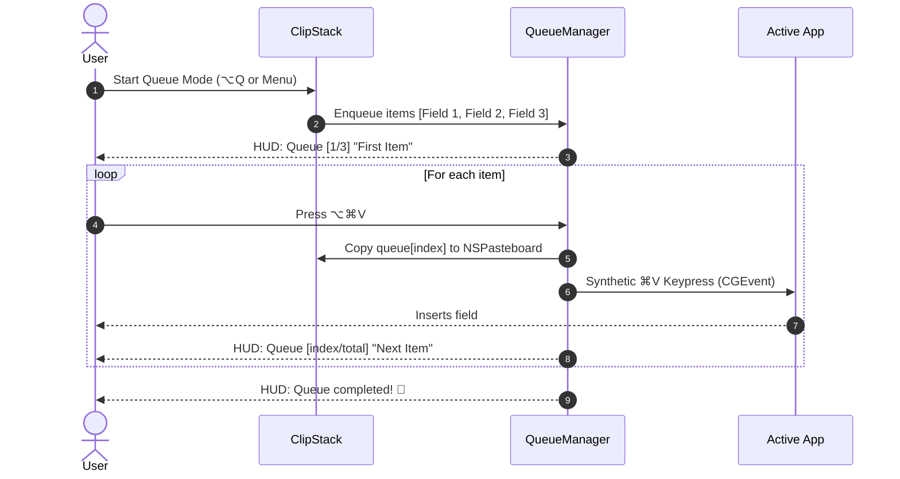

<div align="center">



<br/>

[-black?style=for-the-badge&logo=apple&logoColor=white)](https://apple.com)
[](https://swift.org)
[](https://apple.com)
[-10B981?style=for-the-badge)](https://developer.apple.com/documentation/vision)
[](LICENSE)

<p align="center">
  <b>A native macOS clipboard manager &amp; productivity toolbox with Apple Liquid Glass UI, fluid spring physics, on-device Vision OCR, sequential queue paste, QR generator/scanner, snippets, and sensitive data protection.</b>
</p>

[Key Features](#-key-features) • [UI &amp; Visual Showcase](#-interface-showcase) • [Architecture](#-system-architecture) • [Keyboard Shortcuts](#-keyboard-shortcuts) • [Install &amp; Run](#-installation--quick-start)

</div>

---

## 💡 The Story

Coming from Windows, many power users miss two essential built-in workflows:
1. **Windows Clipboard History (`Win + V`)**: Accessing past copies without losing history when copying new items.
2. **PowerToys / Snipping Tool Text Extractor**: Dragging a box over any image, video frame, or unselectable text on screen to instantly OCR and copy it.

**ClipStack** brings these capabilities natively to macOS, supercharged with Apple's **Vision neural framework** and wrapped in an ultra-smooth **Liquid Glass design** with haptic feedback.

---

## 🔮 Interface Showcase

<div align="center">
  
</div>

---

## ✨ Key Features

### 1. Never Overwrite Copied Items
- Automatically stores copied text, rich text, images, screenshots, and Finder files.
- Configurable history retention: **20, 50, 100, 200, or 500 items**.
- **Pin Items (`⌘P`)**: Keep important snippets permanently in your stack so they never get pruned.

### 2. Apple Vision Framework On-Device OCR & Barcode Scanning (100% Offline)
- **Automatic Background OCR**: When you copy any photo, screenshot, or image file, Apple Vision analyzes it on the neural engine.
- **Search Inside Images**: Search for words that exist *inside* your screenshots to find images immediately.
- **Barcode & QR Code Detection**: Scans any copied screenshot or image for QR codes and barcodes, displaying decoded links with one-click copy or browser open.
- **Extract Text Shortcut (`⌘E`)**: One-key extraction from any image into clean editable text.
- **Screen Region Text Extractor (`⌘⇧2`)**: Drag-select any portion of your screen (videos, PDFs, apps) to instantly extract text.

### 3. Sequential Paste / Queue Mode (`⌥⌘V`)
- Need to copy 5 fields from a spreadsheet and paste them one by one into a form?
- Enter **Queue Mode** (`⌥⌘V` or header button), copy your items, and press **`⌥⌘V`** repeatedly. ClipStack pastes each item in sequential order (FIFO) with a live HUD counter!

### 4. Smart Content Intelligence & Quick Look (`Space`)
Press **`Space`** on any item to slide open the integrated **Liquid Glass Quick Look Drawer**:
- **Instant QR Code Generator**: Generate crisp, high-resolution QR codes directly from any copied text to quickly transfer links or data to your iPhone or Android camera.
- **Hex Color Swatches**: Live color previews for hex codes (`#6366F1`) and RGB with one-click copying.
- **URL & Domain Detection**: Domain detection, favicon tags, and direct **Open in Browser (`⌘O`)**.
- **JSON Beautify / Minify**: One-click format and indent minified JSON strings.
- **Case Converters**: Transform text instantly to `UPPERCASE`, `lowercase`, `Title Case`, `camelCase`, `snake_case`, or `kebab-case`.
- **Developer Tools**: `Base64 Encode/Decode`, `URL Encode/Decode`, `Strip HTML`, and `Strip Markdown`.
- **Text Statistics**: Real-time word count, character count, and line count.

### 5. Permanent Snippets & Reusable Templates
- Create custom canned templates for emails, bios, greetings, and SQL queries with the **`+` New Snippet** button.
- Dedicated **Snippets** tab to quickly access frequently used messages.
- Snippets are pinned permanently and never pruned by history limits.

### 6. Smart Sensitive Data Masking (Privacy Shield)
- Automatically detects and masks sensitive data such as **OpenAI API keys (`sk-...`)**, **GitHub personal access tokens**, **AWS access keys**, **Stripe API keys**, **Private Keys**, and **Credit Card numbers**.
- Shows masked previews by default (`sk-••••••••1234`) with a quick **Reveal / Hide toggle button**.

### 7. Image Compression & Format Conversion
- In the Quick Look drawer for any copied image:
  - **Compress (75%)**: Shrink large retina screenshots by 70–85% with zero visible artifacting.
  - **Resize (50%)**: Half-resolution downscaling for quick chat sharing.
  - **Convert to PNG / JPEG**: One-click format conversion copied directly to your pasteboard.

### 8. Merge & Combine Multiple Clips
- Click the **Merge** button in the header or context menu to combine your recent 3 clips into one clean, formatted block with double-spacing.

### 9. Subtle macOS Audio Feedback & Haptics
- Tactile trackpad haptics paired with native macOS audio cues (`Pop` on paste, `Tink` on copy).
- Can be toggled on/off in the status bar menu.

### 10. Categorized Filtering with Liquid Tabs
- Filter tabs: **All**, **Snippets**, **Text**, **Images**, **Links**, **Code**, and **Pinned**.
- Powered by SwiftUI `matchedGeometryEffect` fluid spring animations that glide across tabs like liquid.

### 11. Export & Backup
- Export your entire clipboard history anytime as formatted **Markdown (`.md`)** or **JSON (`.json`)**.

### 12. Built-in Window Switcher (`⌥Tab`), AltTab-style
- **Hold `⌥` + tap `Tab`** to see every window as a live thumbnail grid; release `⌥` to jump to it. A quick tap goes straight to the previous window with no flash.
- **`⌥` + `` ` ``** shows only the current app's windows.
- **Every Space, including full-screen apps**, plus minimized windows, windows of hidden apps and (optionally) apps with no open windows. Picking a window on another Space switches you there.
- **In-switcher keys:** `⇥`/`⇧⇥`, arrows (grid navigation), `↩`/`Space` select, `W` close, `M` minimize/restore, `F` full screen, `H` hide/unhide app, `Q` quit app, `Esc` cancel. Hover shows close/minimize/full-screen buttons; click to switch.
- **Preview** of the selected window drawn at its real position on screen; Space-number and minimized/hidden/full-screen badges.
- **Settings** (menu bar → Window Switcher → Settings…):
  - **Controls:** hold key `⌥` / `⌃` / `⌘` (`⌘` replaces the system `⌘Tab`); per-shortcut apps / Spaces / screens scope; show delay; hover-to-select; cursor follows focus.
  - **Appearance:** Thumbnails / App Icons / Titles styles; small / medium / large; which screen to show on.
  - **Filters:** minimized, hidden, full-screen and windowless toggles; sort by recently used, app name, title or Space.
  - **Exclusions:** hide an app's windows, or let an app keep the shortcut (games, VMs, remote desktop).
- Written from scratch: Accessibility + ScreenCaptureKit + the window-server calls macOS switchers use for Spaces. Needs **Accessibility** (and **Screen Recording** for thumbnails/titles).

---

## 📊 Feature Comparison

| Capability | macOS Default | Windows 11 (Win+V) | Maccy | Paste App | **ClipStack** |
| :--- | :---: | :---: | :---: | :---: | :---: |
| **Clipboard History Stack** | ❌ (1 item only) | ✅ (25 items) | ✅ | ✅ | **✅ (Up to 500)** |
| **Photo & Screenshot Support** | ❌ | ✅ | ⚠️ Basic | ✅ | **✅ Full Retina** |
| **Search Inside Images (OCR)** | ❌ | ❌ | ❌ | ❌ | **✅ Apple Vision** |
| **QR Code Generator & Scanner** | ❌ | ❌ | ❌ | ❌ | **✅ Built-in Offline** |
| **Interactive Screen OCR** | ❌ | ⚠️ PowerToys | ❌ | ❌ | **✅ Built-in (`⌘⇧2`)** |
| **Sequential Paste (Queue Mode)** | ❌ | ❌ | ❌ | ❌ | **✅ Built-in (`⌥⌘V`)** |
| **Sensitive Data Masking** | ❌ | ❌ | ❌ | ❌ | **✅ Auto-Masked** |
| **Canned Snippets & Templates** | ❌ | ❌ | ❌ | ✅ | **✅ Dedicated Tab** |
| **Image Compression (JPEG/PNG)** | ❌ | ❌ | ❌ | ❌ | **✅ 1-Click Compress** |
| **Merge Clips** | ❌ | ❌ | ❌ | ❌ | **✅ Built-in** |
| **Smart Text Transforms (JSON/Case)** | ❌ | ❌ | ❌ | ⚠️ Limited | **✅ Full Suite** |
| **Color Swatch Preview** | ❌ | ❌ | ❌ | ✅ | **✅ Live Swatch** |
| **Liquid Glass Design & Haptics** | ❌ | ❌ | ❌ | ⚠️ Custom | **✅ Native Liquid Glass** |
| **Zero Subscriptions / 100% Free** | ✅ | ✅ | ✅ | ❌ ($14.99/yr) | **✅ 100% Free & Open** |

---

## 🏗️ System Architecture

ClipStack is built with modern **Swift 5.9**, **SwiftUI**, **AppKit**, and **Apple's Vision Framework**.



---

### Sequential Paste (Queue Mode) Workflow



---

## ⌨️ Keyboard Shortcuts

| Shortcut | Description |
| :--- | :--- |
| **`⌘⇧V`** | Toggle ClipStack Clipboard History popup (customizable: `⌥V`, `⌃⌥V`, etc.) |
| **`⌘⇧2`** | Interactive Screen Text Extractor (drag region & OCR to clipboard) |
| **`⌥⇥`** (hold `⌥`) | Window Switcher: all windows; release `⌥` to switch (`⇧⇥` back, `W` close, `M` minimize, `F` full screen, `H` hide, `Q` quit, `Esc` cancel) |
| **`` ⌥` ``** (hold `⌥`) | Window Switcher: current app's windows only |
| **`⇥` / `⇧⇥`** (in history) | Next / previous filter tab |
| **`⌥⌘V`** | Paste next item in Sequential Queue Mode |
| **`Space`** | **Toggle Quick Look preview drawer, QR code, image compression & text tools** |
| **`↩ (Return)`** | Paste selected item into active application |
| **`⇧↩ (Shift+Return)`** | **Paste as clean Plain Text (strips formatting & line breaks)** |
| **`⌘1` … `⌘9`** | Instant-paste items 1 through 9 |
| **`⌘O`** | Open selected link directly in default browser |
| **`⌘E`** | Extract text from selected image |
| **`⌘P`** | Pin / unpin selected item |
| **`⌘⌫`** | Delete selected item |
| **`Esc`** | Close Quick Look drawer / clear search / dismiss window |

---

## 🚀 Installation & Quick Start

### Option 1: Automatic Build & Install (Recommended)
Clone the repository and run the build script:
```bash
git clone https://github.com/batmandevx/smart-clipboard-mac.git
cd smart-clipboard-mac
./scripts/make-signing-cert.sh   # once: stable local signing so permissions survive rebuilds
./build.sh install
```
This compiles the release binary, signs it, installs it into `/Applications/ClipStack.app`, and launches it immediately.

### Option 2: Build Locally without Installing
```bash
./build.sh
open build/ClipStack.app
```

---

## ⚙️ Permissions & Privacy

- **100% On-Device & Private**: ClipStack makes zero external network requests. All image processing, OCR, QR generation, barcode detection, and clipboard history storage happens locally on your Mac.
- **Accessibility Permission (for Auto-Paste)**:
  To allow ClipStack to simulate `⌘V` when you select an item, enable Accessibility in:  
  **System Settings → Privacy & Security → Accessibility → ClipStack**  
  *(If disabled, ClipStack will still copy the item and show a prompt to press `⌘V`).*  
  The Window Switcher also uses this to bring the exact window you picked to the front.
- **Screen Recording (for the Text Extractor & switcher thumbnails)**:
  **System Settings → Privacy & Security → Screen & System Audio Recording → ClipStack**, then relaunch ClipStack (macOS only applies it after a restart; ClipStack offers a one-click relaunch).  
  Run `./scripts/make-signing-cert.sh` once before building. Without it every rebuild gets a new ad-hoc signature and macOS silently drops this permission.
- **Launch at Login**:
  To have ClipStack start automatically when your Mac turns on:
  Right-click the menu bar icon (or click the ⚙️ gear icon) and verify **Launch at Login** is checked.

---

## 📁 Project Structure

```
smart-clipboard-mac/
├── Package.swift               # Swift Package Manager manifest
├── build.sh                    # Automated release build, codesign & install script
├── Resources/
│   ├── AppIcon.icns            # Retina macOS application icon
│   └── Info.plist              # Bundle metadata & usage descriptions
├── Sources/
│   └── ClipStack/
│       ├── main.swift          # Application entrypoint (NSApplication.shared)
│       ├── AppDelegate.swift   # Menu bar status item, hotkeys, login service
│       ├── ClipboardStore.swift# Pasteboard monitor, image persistence, snippets & export
│       ├── QueueManager.swift  # Sequential Paste (Queue Mode) FIFO manager
│       ├── HistoryPanel.swift  # Liquid Glass UI, Quick Look drawer, tabs & cards
│       ├── SmartText.swift     # QR code, sensitive masking, compression, JSON & case transforms
│       ├── OCR.swift           # Apple Vision framework neural OCR & barcode engine
│       ├── HotKey.swift        # Carbon global hotkey wrapper
│       ├── ScreenshotWatcher.swift # Real-time screenshot directory watcher
│       ├── Utilities.swift     # Liquid glass view modifiers, sound effects, HUD toasts & paster
│       └── Prefs.swift         # User preferences and keyboard presets
└── docs/
    └── assets/
        ├── banner.svg          # Hero graphic
        └── interface_preview.svg # High-res UI mockup
```

---

## 📄 License

This project is licensed under the **MIT License**. See [LICENSE](LICENSE) for details.

---

<div align="center">
  <b>Crafted with ❤️ for macOS by <a href="https://github.com/batmandevx">batmandevx</a></b>
</div>
